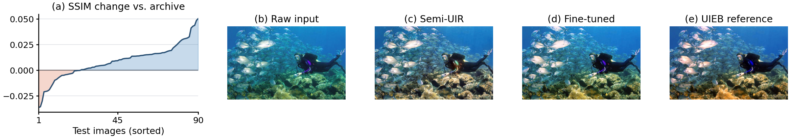

# Semi-UIR / UA-Bank

**Whole-scene underwater image restoration · Deep Learning for Computer Vision Project**

## Project Overview

Underwater photos often have a blue or green cast and lose contrast. Paired reference images are also hard to collect, so we started by asking whether unlabeled images could help a restoration model learn from fewer labeled pairs. Our final model corrects color across the whole frame, then uses a lightweight residual U-Net to refine local details.

[Original Semi-UIR paper (Huang et al., CVPR 2023)](https://arxiv.org/abs/2303.09101) · [Official implementation](https://github.com/Huang-ShiRui/Semi-UIR)

## Key Contributions

- **Uncertainty-aware pseudo-labeling:** Extended the Semi-UIR reliable-bank approach by investigating teacher prediction variability under spatial and color perturbations, preserving uncertain regions of existing bank entries and reducing their influence during training.
- **Fidelity-calibrated pseudo-label selection:** Developed a patch-level error estimator trained on labeled examples to guide bank updates and weight unlabeled training losses.
- **Whole-scene restoration architecture:** Designed a lightweight two-stage network combining global color correction with local residual U-Net refinement.
- **Efficiency-focused evaluation:** Achieved 22.69 dB PSNR and 0.9007 SSIM on the UIEB test set with approximately 288K parameters, outperforming our reproduced Semi-UIR baseline while using about 86% fewer parameters.

## Key Results at a Glance

| Metric | Semi-UIR Reproduction | Final Model |
|---|---:|---:|
| PSNR ↑ | 19.57 dB | **22.69 dB** |
| SSIM ↑ | 0.8709 | **0.9007** |
| Parameters ↓ | 2.013M | **0.288M** |
| CPU Inference ↓ | 209.3 ms | **81.2 ms** |

**Highlights**
- +3.12 dB improvement in PSNR
- +0.0298 improvement in SSIM
- Approximately 86% fewer parameters
- Approximately 2.58× faster CPU inference

All results are based on the same 90-image UIEB test set. The final supervised model uses 200 labeled pairs; the reproduced Semi-UIR baseline uses 200 labeled pairs and 600 unlabeled images.

## How We Developed the Project

**Semi-UIR reproduction.** An exponential-moving-average teacher restores unlabeled images. A reliable bank keeps one candidate restoration per image as a training target, also called a pseudo-label. The student learns from the stored target, and a contrastive loss pulls its output away from the degraded input. The original implementation uses AIM-Net and MUSIQ. For our reproduction, we used a width-32 residual U-Net and UIQM, an underwater image quality score that can be computed without a reference.

Uncertainty-aware bank (UA-Bank). We evaluated the variability in the teacher’s predictions under flipped inputs and minor color-cast perturbations. For accepted updates, the previous values at the most uncertain pixels in existing bank entries were preserved, while uncertain regions were assigned lower weights when calculating the loss on unlabeled images. Color perturbations correlated more closely with pixel error than flips, although the correlation remained weak. In the 50-label baseline, the bank’s PSNR against reference images reserved for diagnostics reached a peak of 19.46 dB and finished at 18.88 dB, despite updates being selected using UIQM.

Fidelity-calibrated bank. We trained a small regressor on labeled pairs to estimate restoration error at the patch level. The regressor evaluates both the current teacher output and the stored candidate, and its error estimates are also used to determine each patch’s contribution to the loss on unlabeled images. Using the same whole-scene architecture and 50 labeled pairs, the supervised control achieved 22.60 dB, while the fidelity-bank run achieved 22.53 dB. The paired difference was −0.07 dB (95% bootstrap CI: −0.17 to +0.03 dB).

## Proposed Model and Architecture

We replaced patch-based semi-supervised training with a two-stage supervised recipe that uses whole frames. The final model has 288,163 parameters and restores each image in one forward pass.

1. **Global color correction.** We compute RGB percentiles, means, and standard deviations from a 48 × 48 thumbnail. A small network uses those statistics to predict how to mix the RGB channels and adjust each channel's tone curve. This gives the model enough context to correct a cast that affects the whole scene.
2. **Local refinement.** A width-12 residual U-Net takes the globally corrected image, the original input, and a percentile-stretched view as inputs. It predicts the remaining changes to color and detail at each location.

## UIEB Results

All methods were evaluated on the same 90 UIEB test pairs. The Semi-UIR reproduction used 600 unlabeled training images alongside its 200 labeled pairs. The two 200-label whole-scene runs used the same labeled pairs. Higher PSNR means lower pixel error, while higher SSIM means closer agreement with the reference in local image structure.

| Method | Labeled pairs | PSNR ↑ (dB) | SSIM ↑ | Parameters | CPU latency ↓ |
|---|---:|---:|---:|---:|---:|
| Raw input | — | 16.4214 | 0.7378 | — | — |
| Semi-UIR (our reproduction) | 200 | 19.5702 | 0.8709 | 2.013M | 209.3 ms |
| Whole-scene supervised (archived) | 50 | 22.6006 | 0.8923 | 0.288M | 82.2 ms |
| Whole-scene supervised (from scratch) | 200 | **22.6952** | 0.8999 | 0.288M | 81.8 ms |
| **Whole-scene supervised + fine-tuning** | 200 | 22.6882 | **0.9007** | 0.288M | 81.2 ms |

*We report the median latency of 30 single-image float32 passes after warm-up. We used 256 × 341 inputs and six CPU threads on a Ryzen 5 5600H and excluded image I/O.*

- With **200 labeled pairs**, our final model improved PSNR by **3.12 dB** and SSIM by **0.0298** over our Semi-UIR reproduction while using about **86% fewer parameters**.
- Against the **matched 200-label model**, larger-frame fine-tuning added **0.00085 SSIM** (paired 95% CI **0.00052 to 0.00119**). PSNR changed by **−0.007 dB**.
- Against the **50-label archive**, the final model improved SSIM on **66 of 90 images**, with a mean gain of **0.0084**. This comparison includes 150 additional labeled pairs. The PSNR gain of **0.09 dB** was inconclusive, with a paired interval spanning zero. When we excluded test image `0067.png`, which duplicated an image in the unlabeled pool, the SSIM gain was **0.0085**.

The final model also scored **3.7410 UIQM** and **0.3737 UCIQE**, two underwater image quality metrics that do not require a reference. [Benchmark scores](results/scene_l200_benchmark.csv) · [Per-image scores](results/scene_l200_by_image.csv) · [Paired comparisons](results/scene_l200_paired.csv) · [89-image analysis](results/scene_l200_no_overlap.csv)



*The plot shows per-image SSIM changes against our archived 50-label model. The example on the right is UIEB image `0005.png`.*

## Future Work

- **Architecture ablation:** Quantify the individual contributions of global color correction, percentile-stretched input, and residual refinement.
- **Cross-dataset validation:** Evaluate restoration quality on additional underwater datasets and real-world imagery.
- **Improved confidence estimation:** Explore pseudo-label selection methods that more accurately predict restoration error.
- **Model optimization:** Investigate quantization, ONNX export, and deployment on edge devices.
- **Perceptual evaluation:** Study whether improvements in PSNR and SSIM consistently correspond to human-perceived image quality.

## Environment and Dependencies

Use Python 3.11, PyTorch 2.5.1, and torchvision 0.20.1. Install `curl` for dataset preparation. We ran the original bank experiments on an Apple M2 MacBook Air with 8 GB RAM and the whole-scene follow-ups on CPU. The latency benchmark used a Ryzen 5 5600H with six threads and PyTorch 2.0.

From the repository root, create and activate a fresh virtual environment.

```sh
python -m venv .venv
```

Activate it with `.\.venv\Scripts\Activate.ps1` in Windows PowerShell or `source .venv/bin/activate` on macOS or Linux. For a CPU-only setup on Windows or Linux, run both commands below. On macOS, run only the second command to use the standard build with MPS support.

```sh
python -m pip install torch==2.5.1 torchvision==0.20.1 --index-url https://download.pytorch.org/whl/cpu
python -m pip install -r requirements.txt
```

For an optional NVIDIA GPU setup, replace the first installation command with the CUDA 12.4 command below and then install the requirements. PyTorch also provides CUDA 11.8 and 12.1 wheels for these versions. Use a driver compatible with the wheel you choose. [requirements.txt](requirements.txt) · [PyTorch installation options](https://pytorch.org/get-started/previous-versions/#v251)

```sh
python -m pip install torch==2.5.1 torchvision==0.20.1 --index-url https://download.pytorch.org/whl/cu124
```

## Dataset Preparation

The preparation script downloads UIEB, converts the images to RGB PNGs, and resizes each image so that its shorter side is 256 pixels while preserving its aspect ratio. Run the first command for the main 200-label benchmark. Second command derives the 50-label split used in the earlier experiments. [UIEB project](https://li-chongyi.github.io/proj_benchmark.html) · [Dataset download mirror](https://huggingface.co/datasets/Hikari0608/UIEB)

```sh
python data/prepare_uieb.py --root data/UIEB --n_labeled 200 --short 256
python data/make_lowlabel_split.py --src data/UIEB --dst data/UIEB/L50 --n_labeled 50
```

```text
data/UIEB/
├── labeled/
│   ├── input/                200 training images
│   └── gt/                   200 matching references
├── unlabeled/input/          600 training inputs
├── unlabeled_gt_analysis/    references reserved for bank diagnostics
├── test/
│   ├── input/                90 test images
│   └── gt/                   90 matching references
└── L50/                      same layout with 50 labeled and 750 unlabeled inputs
```

Keep the same filename for each input and its corresponding reference.

## Training

```sh
python train.py --config configs/baseline.yaml --name reproduce_baseline
python train.py --config configs/scene_supervised_l200.yaml --device cpu --name reproduce_scene_l200
python train.py --config configs/scene_finetune_l200.yaml --device cpu --init checkpoints/reproduce_scene_l200/final.pth --name reproduce_finetune_l200
```

| Run | Training view | Updates | Batch | Initial learning rate |
|---|---|---:|---|---:|
| Semi-UIR reproduction | 128 × 128 crops | 8,000 | 4 labeled + 4 unlabeled | 0.0002 |
| Whole-scene stage 1 | 96 × 96 full-frame views | 1,100 | 4 labeled | 0.001 |
| Whole-scene stage 2 | 128 × 176 full-frame views | 240 | 4 labeled | 0.00035 |

All three configurations use seed 0 and Adam with cosine decay. The baseline uses an EMA decay of 0.996 and initializes the restoration network from scratch. Torchvision downloads ImageNet-pretrained VGG-16 weights for its feature losses on the first run. Stage 1 starts from scratch. Stage 2 uses `--init` to load the student weights from stage 1. We fine-tune on larger frames with paired exposure and gamma jitter. The fine-tuning objective also adds a channel-mean loss for overall color and brightness and a log-MSE term for per-image error. Each command saves `checkpoints/<name>/final.pth` and `results/logs/<name>.jsonl`.

## Inference and Evaluation

Run the following after training to evaluate the student checkpoints. The evaluator reads input images and references from `data/UIEB/test/input` and `data/UIEB/test/gt`, saves restored PNGs in a subfolder for each run, and writes the mean, per-image, and paired comparison CSVs. It reports PSNR, SSIM, UIQM, and UCIQE. To evaluate a subset, list one test filename per line in a text file and pass it with `--names path/to/filenames.txt`.

```sh
python eval.py --data_root data/UIEB --split test --device cpu --threads 6 --weights student --with_input --ckpt checkpoints/reproduce_baseline/final.pth checkpoints/reproduce_scene_l200/final.pth checkpoints/reproduce_finetune_l200/final.pth --save_dir results/outputs/recheck --csv results/outputs/recheck/metrics.csv --per_image_csv results/outputs/recheck/by_image.csv --compare reproduce_finetune_l200 reproduce_baseline --compare reproduce_finetune_l200 reproduce_scene_l200 --comparison_csv results/outputs/recheck/paired.csv
```

To score the original checkpoints used for the report, place them at the paths listed in the checkpoint table and run this command. The comparison arguments use the run names saved inside those checkpoints.

```sh
python eval.py --data_root data/UIEB --split test --device cpu --threads 6 --weights student --with_input --ckpt checkpoints/baseline/final.pth checkpoints/archive/scene_supervised_l50_22.6006dB/final.pth checkpoints/scene_supervised_l200/final.pth checkpoints/scene_finetune_l200/final.pth --save_dir results/outputs/report_recheck --csv results/outputs/report_recheck/metrics.csv --per_image_csv results/outputs/report_recheck/by_image.csv --compare scene_finetune_l200 scene_supervised_l50 --compare scene_finetune_l200 scene_supervised_l200 --comparison_csv results/outputs/report_recheck/paired.csv
```

## Checkpoints, Configs, and Logs

The original baseline checkpoint is in the companion `Semi-UIR-UABank_share.zip` archive under `Semi-UIR-UABank/checkpoints/baseline/final.pth`. The checkpoint guide lists the expected paths and SHA-256 checksums for the whole-scene weights. Obtain those files from the team for the exact checkpoint comparison, or run the training commands above to generate fresh checkpoints. [Checkpoint guide](checkpoints/README.md) · [SHA-256 checksums](checkpoints/SHA256SUMS)

| Run | Original checkpoint path | Config | Recorded training log |
|---|---|---|---|
| Semi-UIR reproduction | `checkpoints/baseline/final.pth` | [YAML](configs/baseline.yaml) | [JSONL](results/logs/baseline.jsonl) |
| Whole-scene supervised (50 labels) | `checkpoints/archive/scene_supervised_l50_22.6006dB/final.pth` | [YAML with the matched supervised override](configs/fidelity_l50.yaml) | [JSONL](results/logs/scene_supervised_l50.jsonl) |
| Whole-scene supervised (200 labels) | `checkpoints/scene_supervised_l200/final.pth` | [YAML](configs/scene_supervised_l200.yaml) | [JSONL](results/logs/scene_supervised_l200.jsonl) |
| Whole-scene fine-tuned (200 labels) | `checkpoints/scene_finetune_l200/final.pth` | [YAML](configs/scene_finetune_l200.yaml) | [JSONL](results/logs/scene_finetune_l200.jsonl) |

[Original baseline and UA-Bank metrics](results/metrics.csv)

## Code Organization

| Where to look | What it contains |
|---|---|
| [models/unet.py](models/unet.py) | Baseline `UNet` and our `SceneColorUNet` with global correction and local refinement |
| [train.py](train.py) | Baseline and whole-scene training, including the `scene_loss` objective and fine-tuning with `--init` |
| [semiuir/data.py](semiuir/data.py) | Whole-frame training views and paired exposure and gamma augmentation |
| [semiuir/uncertainty.py](semiuir/uncertainty.py), [semiuir/bank.py](semiuir/bank.py), [semiuir/fidelity.py](semiuir/fidelity.py) | Uncertainty estimation, bank updates, and calibrated patch error |
| [eval.py](eval.py), [semiuir/metrics.py](semiuir/metrics.py) | Image export, restoration metrics, and per-image comparisons |
| [docs/experiments.md](docs/experiments.md) | Development split, 50-label experiments, and reproduction details |
